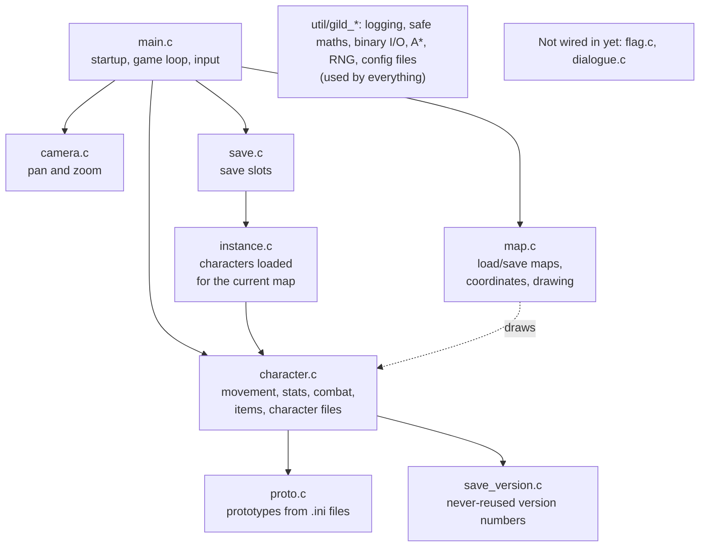
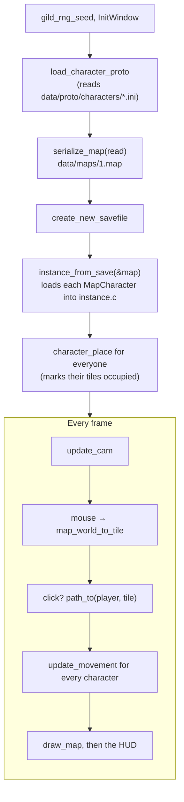
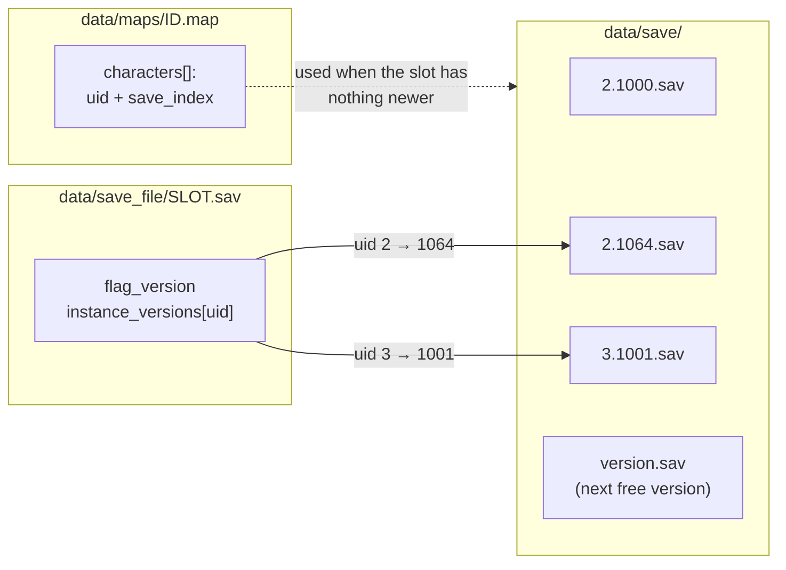
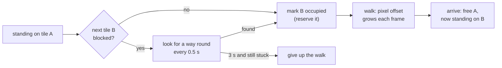

# Coda

## Gild

Gild is my utils library. It's just included in file form here, it has some special compilation steps which I'll quickly list below.

Gild requires the following:
- C11 

#### Windows
- VS 2019 16.8+ for windows
- /utf-8 
- fopen/sscanf/strerror are deprecated so we compile with '_CRT_SECURE_NO_WARNINGS'
- For none MSVC/MinGW we do "_USE_MINGW_ANSI_STDIO=1" for printf(%zu)

# Architecture

# How Coda fits together

A map of the code, so you can find your way around without reading every file.
Read this first, then open only the file you need.

The whole game is three layers:

1. **Data**: a `Map` (tiles, props, which characters live there) and
   `CharacterInstance`s (stats, inventory, where they stand).
2. **Saving**: every character is its own file. A save slot is just a list saying
   *which version* of each character's file to load.
3. **Each frame**: input picks a path, `update_movement` walks along it,
   `draw_map` draws everything back to front.

Everything else is detail inside one of those.

---

## The modules



| File | What it owns | Size |
|---|---|---|
| `main.c` | Startup, the frame loop, mouse/keyboard. Also a **temporary** demo-map builder (delete once the editor is back). | ~220 |
| `map.c` | Loading/saving `.map` files, tile ↔ pixel maths, the texture cache, `draw_map`. | ~580 |
| `camera.c` | Middle-mouse pan, wheel zoom, keeping zoom right when the window resizes. | ~60 |
| `character.c` | Everything a character *does*. Five sections, see below. | ~650 |
| `proto.c` | Reads `data/proto/**/<id>.ini` into `CharacterPrototype` / `ItemPrototype`. | ~230 |
| `instance.c` | The array of characters for the current map. | ~75 |
| `save.c` | Save slots: which character versions make up a save. | ~200 |
| `save_version.c` | Hands out version numbers that are never reused. | ~105 |
| `flag.c`, `dialogue.c` | Built, not used yet (for doors, containers, conversations). | |
| `util/gild_*` | General-purpose helpers, not game-specific. `gild_old.*` and `gild_hash.*` are unused. | |

### Inside `character.c` (the big one)

It reads like five small files back to back. Jump to the section you need:

| Section | Functions | In one line |
|---|---|---|
| Movement and occupancy | `character_place`, `character_unplace`, `path_to`, `update_movement`, `stop_movement`, `is_moving` | Walk a path one tile at a time without bumping into anyone. |
| XP and levels | `level_up`, `get_xp_to_level`, `get_unused_skill_points` | 1000 XP per level, one skill point per level. |
| Combat and stats | `target_character`, `health_character`, `skill_check`, `get_skill`, `get_derived`, `get_ac` | 3d6 roll-under checks, damage reduced by armour. |
| Items | `add_item`, `remove_item`, `equip_item`, `unequip_item` | Inventory stacks; equipping moves an item to the hotbar. |
| Character files | `instance_character`, `serialize_character`, `free_character` | Load/save one character as `data/save/<uid>.<version>.sav`. |

---

## Startup and one frame



Right now `main.c` creates the player separately with `instance_character(PLAYER_UID, ...)`,
and `instance_from_save` skips uid 1 if a map lists it. **Planned change:** the player
becomes uid 1 in each map's character list, controlled by input instead of AI, and
saves like everyone else.

---

## Saving and loading



**Save** (`save_from(slot)`):
1. `save_character_storage` writes every loaded character to a **brand-new** file
   (`serialize_character` → `save_version_next`). Old files are never overwritten,
   so no slot can damage another.
2. The slot records the new version for each uid, then is written itself.

**Load** (`load_from(slot)`, then `instance_from_save(&map)`):
1. Read the slot's version list.
2. For each character the map lists, load whichever is newer: the slot's version or
   the map's `save_index`. Game saves are always 1000 or above and hand-made files
   below 1000, so a saved game always wins.
3. No file for that version? The character starts blank.

**Rule that keeps this safe:** loading always reads into a temporary copy and only
replaces the real data once the whole file has read cleanly. Writing goes to
`<file>.tmp` and is renamed over the old file only once it has written cleanly.
A crash or a full disk can't leave half a save behind.

---

## Maps and the screen

Tiles are 64×32 diamonds. Tile (0,0) is the top corner, `+x` goes down-right,
`+y` goes down-left:

```
            (0,0)
        (0,1)   (1,0)
    (0,2)   (1,1)   (2,0)        a diagonal = all tiles with the same x + y
        (1,2)   (2,1)
            (2,2)
```

- `map_tile_to_world(m, x, y)` gives the pixel centre of a tile (its **anchor**).
  `map_world_to_tile` goes back (used for mouse clicks).
- Every texture is 64×96: the diamond is the bottom 32 rows, the space above is for
  walls and characters. All textures are drawn with the diamond's centre on the anchor.
- **Draw order** (`draw_map`): one diagonal at a time, back to front. Each tile's floor
  then its prop, then the characters on that diagonal, then ceilings on top
  (except the one the player is under). Nearer walls naturally cover characters
  behind them.

Per-tile arrays are `floors[]`, `props[]` and `flags[]`, indexed `y * w + x`.
`flags` bits:

| Bit | Name | Saved? | Meaning |
|---|---|---|---|
| 0 | `MAP_FLAG_COLLIDE` | yes | A wall. Nobody can stand here. |
| 1 | `MAP_FLAG_OCCUPIED` | **no** | A character is here (or is stepping onto it). |

### How a character takes one step (`update_movement`)



Reserving *before* stepping is what stops two characters walking into the same tile.

---

## Files on disk

| Path | Written by | What it is |
|---|---|---|
| `data/maps/<id>.map` | `serialize_map` | One map: tiles, props, flags, characters, ceilings, transitions. |
| `data/save/<uid>.<version>.sav` | `serialize_character` | One saved copy of one character. Never overwritten. |
| `data/save/version.sav` | `save_version.c` | The next version number to hand out. |
| `data/save_file/<slot>.sav` | `serialize_save_file` | One save slot. |
| `data/save/flag_<version>.sav` | `serialize_flag` | Flags (not wired up yet). |
| `data/proto/characters/<id>.ini` | you, by hand | Character stats and sprite. |
| `data/proto/items/<id>.ini` | you, by hand | Item stats. |
| `assets/textures/<id>.png` | you | 64×96 tiles, props and sprites. A character uses 4 in a row, one per facing. |

---

## "I want to change…"

| …this | Look at |
|---|---|
| How fast characters walk | `MOVE_SPEED` at the top of `character.c` |
| How long someone waits when blocked | `REPATH_INTERVAL`, `BLOCKED_GIVE_UP` in `character.c` |
| What happens when you click | the "Input" block in `main.c`'s loop |
| Draw order, shadows, placeholders | the drawing section at the bottom of `map.c` |
| Which texture faces which way | `FACING_TEXTURE` in `map.c` |
| Zoom limits or speed | top of `camera.c` |
| Stats, skills, derived values | `STAT_LIST` / `SKILL_LIST` in `character.h`, `get_skill` / `get_derived` in `character.c` |
| Dice rolls | `skill_check` in `character.c`, `gild_rng` in `util/gild_rand.c` |
| The map file format | the layout comment at the top of `map.c` |
| What goes in a character save | `serialize_character` in `character.c` |

---

## Known gaps (as of this writing)

- A map can't say where a character starts (`MapCharacter` has no position), so
  characters with no save file begin on tile 0,0. The demo spreads them out by hand.
- The player is created separately in `main.c` and isn't saved yet (see the planned change above).
- Transitions are stored in maps but nothing uses them yet.
- Flags, dialogue, doors and containers: later.
